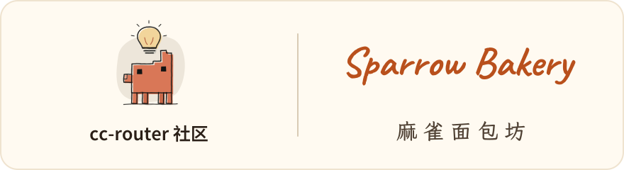

<p align="center">
  
</p>

<p align="center"><a href="README.md">中文</a></p>

# Sparrow Bakery

**Sparrow Bakery** is the catalog behind the plugin store of [cc-router](https://github.com/finch-xu/cc-router). The app's **Plugins** page reads the `index.json` generated from this repository.

Plugin types available today:

| Type | Folder | What it changes |
|---|---|---|
| UI theme | `plugins/theme/` | colors, shapes, textures, fonts |
| Receipt theme | `plugins/receipt/` | HTML template + CSS + fonts, see [docs/receipt-api.md](docs/receipt-api.md) |

**Plugins are data, never code.** A theme can only fill in a published token table ([docs/theme-api.md](docs/theme-api.md)) — no CSS selectors, no network access, no scripts. That's why redesigns of cc-router won't leave your theme half-applied.

## What lives here

Only **pointers** and showcase images; the plugin itself stays in your own repository:

```
plugins/theme/<plugin id>.json   ← your repo + commit + tags
media/<plugin id>/logo.png       ← optional, ≤ 100 KB
media/<plugin id>/shot-1.png     ← optional, ≤ 500 KB each, up to 4
```

`index.json` is generated by CI — don't edit it by hand.

## Let AI build it for you

This repo is also a Claude Code plugin marketplace. Its **cc-router plugin kit** ships three skills that load on demand:

| Skill | What it does |
|---|---|
| `cc-router-theme` | Builds a UI theme: palette, `theme.json`, contrast checks, and a light/dark preview |
| `cc-router-receipt` | Builds a receipt theme: template and CSS, plus previews with sample data under three display settings |
| `cc-router-submit` | Pushes a finished plugin to GitHub, pins the commit, and opens the PR here; also handles new versions |

Install it in Claude Code:

```
/plugin install cc-router-plugin-kit --marketplace finch-xu/cc-router-community
```

On older Claude Code it takes two steps: `/plugin marketplace add finch-xu/cc-router-community`, then `/plugin install cc-router-plugin-kit@cc-router-community`.

Then just ask, for example "make me a forest-green cc-router theme" or "make a train-ticket style receipt". The bundled validator runs **the same** validation code as cc-router: the first run shallow-clones it into `~/.cache/cc-router-plugin-kit/`, which needs git and Node 22.18+. So when the script passes, the app and this repo's CI will pass too.

Using another AI tool that supports Agent Skills? Copy the folders under [`agent-skills/skills/`](agent-skills/skills/) into that tool's skills directory.

## Making a theme

1. Create a **public** GitHub repo with two files at its root (or in a subfolder): `cc-router-plugin.json` (the manifest) and `theme.json` (the theme). See the Chinese README for annotated examples, [docs/theme-api.md](docs/theme-api.md) for every token, and [`examples/plugins/sparrow-sun`](https://github.com/finch-xu/cc-router/tree/main/examples/plugins/sparrow-sun) in the cc-router repo for a complete one.
2. Debug locally: cc-router → **Plugins** → **Load from folder**, then **Try on** before installing.
3. After pushing, try **Install from link** with `https://github.com/you/repo/tree/<commit>` — the same path users take.

`id`: lowercase letters, digits and hyphens (2–40 chars), not a built-in theme name.

Receipt plugins use `"type": "receipt"` and `"entry": "receipt.json"`; see [docs/receipt-api.md](docs/receipt-api.md) and [`examples/plugins/receipt-sparrow-bakery`](https://github.com/finch-xu/cc-router/tree/main/examples/plugins/receipt-sparrow-bakery).

## Submitting

1. Fork this repo.
2. Add `plugins/theme/<id>.json` (receipts go in `plugins/receipt/<id>.json`):

   ```json
   {
     "repo": "you/my-theme",
     "tags": ["warm", "light"],
     "versions": [{ "commit": "<full 40-character commit SHA>" }]
   }
   ```

   Add `"path": "subfolder"` if the repo holds several plugins. Pick tags from [`schema/tags.json`](schema/tags.json) (max 5); new tags can be added in the same PR.
3. Optionally add `media/<id>/logo.png` and `media/<id>/shot-1.png`… (png / jpg / webp).
4. Open a PR. CI downloads the files at your commit and checks them with **the same validator the app uses**; results appear in the PR's check summary.

Name, description and version come from your manifest; CI computes the package hash.

**New versions:** bump `version` in your manifest, then open a PR appending the new commit to the **end** of `versions`.

## Rules

Public repos only; an open-source license is recommended. Don't impersonate cc-router or other brands. Screenshots must show the real theme. Font licensing is the author's responsibility. Problematic plugins are withdrawn with `"revoked": "reason"`, and the app notifies users who installed them.
